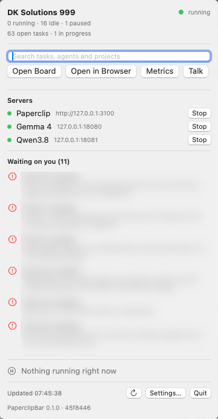

# PaperclipBar

**Paperclip in your Mac's menu bar.** A free macOS app from [DK Solutions 999](https://www.dksolutions999.com).

PaperclipBar shows what needs your attention in the Paperclip instance running on your Mac, what your agents
are working on, and whether Paperclip and your local model servers are running. It opens the Paperclip board
in its own window, shows metrics, starts and stops servers, and lets you dictate a new task.

## Download

- **[Download PaperclipBar for Mac](https://github.com/btroop202/PaperclipBar-releases/releases/latest/download/PaperclipBar.zip)** (latest version)
- **[User manual (PDF)](https://github.com/btroop202/PaperclipBar-releases/releases/latest/download/PaperclipBar-manual.pdf)**
- Every version, with release notes and checksums: [Releases](https://github.com/btroop202/PaperclipBar-releases/releases)



*The panel. Task titles are blurred in this example.*

## Requirements

- A Mac with Apple silicon (M-series). PaperclipBar does not run on Intel Macs.
- macOS 14 Sonoma or later. Talk (dictating a task) needs macOS 26 or later.
- Paperclip running on the same Mac, by default at `http://127.0.0.1:3100`.
- A Paperclip board API key.

## Install

1. Download `PaperclipBar.zip`, open it, and move **PaperclipBar** into your **Applications** folder.
2. Open PaperclipBar. The first time, macOS says it cannot verify the app, because PaperclipBar is not
   notarized by Apple. Open **System Settings › Privacy & Security**, scroll to **Security**, click
   **Open Anyway** next to PaperclipBar, and confirm.
3. Click the paperclip icon in the menu bar, then **Open Settings…**, and paste a board API key into the
   **Access** tab. With the Paperclip command-line tool, for example:
   ```bash
   paperclipai token board create --name "PaperclipBar" --ttl-days 30
   ```
4. If macOS asks whether PaperclipBar may use the key in your keychain, enter your Mac login password and
   click **Always Allow**. It asks again once after each update.

The [user manual](https://github.com/btroop202/PaperclipBar-releases/releases/latest/download/PaperclipBar-manual.pdf)
covers every setting and feature.

## Verify your download

Each release lists the SHA-256 checksum of its files. In Terminal:

```bash
shasum -a 256 ~/Downloads/PaperclipBar.zip
```

The result must match the checksum in the release notes.

## Privacy

- PaperclipBar connects only to Paperclip and to model servers on your own Mac (`127.0.0.1`). It sends
  nothing anywhere else and contains no analytics.
- Your API key is stored in your login Keychain, never in the app's settings.
- A dictated task's transcript is never written to disk. Recording happens only while you hold the shortcut
  or until you click Stop, and macOS shows its microphone indicator throughout.

## Support

- Website: [www.dksolutions999.com](https://www.dksolutions999.com)
- Email: [customersupport@dksolutions999.com](mailto:customersupport@dksolutions999.com)

Please include the version from **Settings › About**.

This repository holds release downloads only; PaperclipBar's source code is not published here.
PaperclipBar is free to use under the DK Solutions 999 [Terms of Use](https://www.dksolutions999.com/terms.html).
